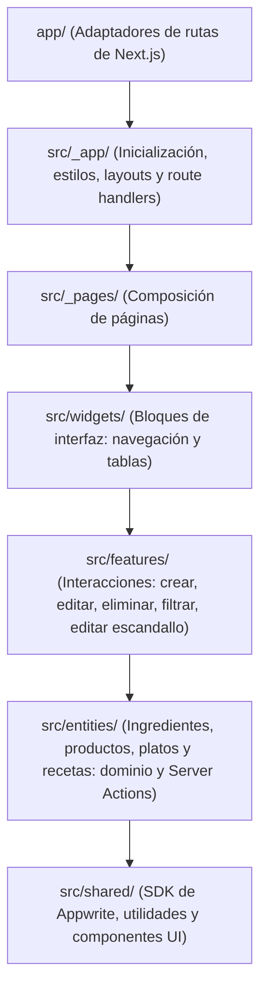

# 🍳 CocinaOS

[](https://nextjs.org/)
[](https://react.dev/)
[](https://www.typescriptlang.org/)
[](https://tailwindcss.com/)
[](https://appwrite.io/)
[](https://vitest.dev/)
[](https://pnpm.io/)
<br>
[](#)
[](#)
[](#)
[](#)

Inventario y gestión para cocinas profesionales. Permite administrar ingredientes, productos y platos, y preparar escandallos con cantidades útiles, mermas y costes por ración. La interfaz está en español.

## Contenido

- [Estado actual](#estado-actual)
- [Instalación y configuración](#instalación-y-configuración)
- [Modelo de datos de Appwrite](#modelo-de-datos-de-appwrite)
- [Cómo comprobar el proyecto](#cómo-comprobar-el-proyecto)
- [Arquitectura y documentación](#arquitectura-y-documentación)
- [Límites y seguridad](#límites-y-seguridad)
- [Próximos pasos](#próximos-pasos)
- [Licencia](#licencia)

## Estado actual

| Ruta | Funcionalidad disponible |
| :--- | :--- |
| `/` | Portada con ejemplos ilustrativos del producto. |
| `/ingredientes` | Alta, edición y eliminación; stock, unidades `G`, `KG`, `ML`, `L`, precio de compra neto, búsqueda y filtros. |
| `/productos` | Catálogo con categoría, precio de venta, precio de compra, unidades en stock y fotografía opcional. |
| `/platos` | Platos con PVP, raciones listas, fotografía y edición de receta. |
| `/escandallos` | Ficha por plato: ingredientes, cantidades útiles, conversión de unidades, merma, coste por ración y rentabilidad. |
| `/api/storage/dishes/[fileId]` | Lectura de imágenes del bucket, utilizada por platos y productos. |

El stock bajo se señala a partir de cantidades menores o iguales a 5. Los cálculos de raciones posibles usan las existencias de ingredientes y sus mermas; no equivalen al stock de platos ya preparados. El guardado de la ficha en `/escandallos` utiliza una transacción y comprueba conflictos de edición.

Stack: Next.js 16.3.5 (App Router), React 19.2.8, TypeScript 5, Tailwind CSS 4, Base UI, shadcn/ui, Hugeicons, Sonner y Appwrite TablesDB/Storage. Las versiones declaradas están en [package.json](package.json) y las resueltas en [pnpm-lock.yaml](pnpm-lock.yaml).

## Instalación y configuración

### 1. Requisitos

- Node.js compatible con todas las herramientas: Vitest requiere `^22.12.0 || ^24.0.0 || >=26.0.0`. Next.js por sí solo admite `>=20.9.0`, pero Node 20 no cubre la suite actual.
- pnpm **12.3.4**, fijado en `packageManager` de `package.json`.
- Un proyecto Appwrite con TablesDB, las cuatro tablas descritas abajo y un bucket para imágenes. El backend debe admitir las transacciones utilizadas por el SDK `node-appwrite` instalado.

Comprueba las versiones:

```bash
node --version
pnpm --version
```

### 2. Dependencias y entorno

Desde la raíz de este repositorio:

```bash
pnpm install --frozen-lockfile
cp .env.example .env.local
```

Si ya tienes `.env.local`, conserva su contenido en lugar de sobrescribirlo. Completa las variables de la [plantilla](.env.example):

| Variable | Valor esperado |
| :--- | :--- |
| `NEXT_PUBLIC_APPWRITE_ENDPOINT` | Endpoint regional del proyecto, por ejemplo `https://fra.cloud.appwrite.io/v1`. |
| `NEXT_PUBLIC_APPWRITE_PROJECT_ID` | ID del proyecto Appwrite. |
| `APPWRITE_API_KEY` | Clave de servidor con acceso de lectura/escritura a las filas, transacciones y archivos que utiliza la aplicación. Para la autenticación también requiere `sessions.write`, `teams.read` y `teams.write`. |
| `KITCHEN_TEAM` | ID del equipo de cocina en Appwrite Auth. |
| `CLIENTS_TEAM` | ID del equipo de clientes en Appwrite Auth. |
| `APPWRITE_DATABASE_ID` | ID de la base TablesDB. |
| `APPWRITE_TABLE_INGREDIENTES_ID` | ID de la tabla de ingredientes. |
| `APPWRITE_TABLE_PRODUCTOS_ID` | ID de la tabla de productos. |
| `APPWRITE_TABLE_PLATOS_ID` | ID de la tabla de platos. |
| `APPWRITE_TABLE_RECETAS_ID` | ID de la tabla de líneas de receta. |
| `APPWRITE_BUCKET_FOTOS_ID` | ID del bucket compartido por platos y productos. |

La aplicación también admite `APPWRITE_ENDPOINT` y `APPWRITE_PROJECT_ID` como alternativa a sus equivalentes `NEXT_PUBLIC_*`. El cliente se inicializa en `src/shared/api/db.ts`. Next.js carga `.env.local` antes que `.env`; evita valores contradictorios y reinicia el servidor tras cambiarlos. Nunca añadas el prefijo `NEXT_PUBLIC_` a la clave secreta.

La instalación no crea tablas, relaciones ni archivos de ejemplo. Configura Appwrite antes de comprobar las páginas operativas.

### 3. Arranque

```bash
pnpm dev
```

Abre [http://127.0.0.1:3000](http://127.0.0.1:3000). El script de desarrollo escucha en `127.0.0.1`.

Para comprobar producción:

```bash
pnpm build
pnpm start
```

La compilación descarga Figtree mediante `next/font/google`, por lo que necesita acceso a Google Fonts. Un fallo de red en esta fase no equivale a un error de TypeScript.

## Modelo de datos de Appwrite

Las claves distinguen mayúsculas y minúsculas. Los nombres visibles de las tablas pueden variar: los IDs del entorno determinan cuáles se utilizan. `$id`, `$createdAt` y `$updatedAt` los proporciona Appwrite.

### Ingredientes

| Columna | Tipo | Contrato de la aplicación |
| :--- | :--- | :--- |
| `nombre` | String, 255 | Obligatorio. |
| `descripcion` | String, 1000 | Opcional; admite `null`. |
| `stock` | Float | Obligatorio, igual o mayor que 0; admite fracciones. |
| `unidad_de_masa` | Enum | Obligatorio: `G`, `KG`, `ML`, `L`. |
| `precio_compra` | Float | Opcional, sin valor predeterminado; euros netos por una unidad de compra, hasta 4 decimales. |
| `merma_habitual` | Float | Opcional; porcentaje de referencia, de 0 a 99,99. |

Si falta `precio_compra`, crea una columna Float no requerida, mínimo 0 y sin valor predeterminado. Espera a que esté disponible. Las filas sin precio se muestran como «Sin precio» y no se reinterpretan importes anteriores. La calculadora de compra guarda el precio neto, no el IVA ni el importe bruto.

La merma habitual puede leerse desde Appwrite; el formulario actual de ingredientes no permite editarla. En el escandallo se puede indicar una merma específica por línea, que prevalece sobre la habitual.

### Productos

| Columna real de Appwrite | Tipo | Campo en la aplicación |
| :--- | :--- | :--- |
| `Nombre` | Text | `nombre`, obligatorio al crear. |
| `Cantidad` | Integer | `stock`, unidades no negativas. |
| `Categoria` | Text | `categoria`, obligatoria al crear. |
| `precio` | Float | `precio`, venta, obligatorio al crear. |
| `precio_compra` | Float | `precio_compra`, obligatorio al crear. |
| `fotos` | Text | `foto`, ID de archivo opcional. |

Estas columnas son opcionales en el esquema conectado; los requisitos anteriores los valida la aplicación. No crees columnas alternativas como `Precio`, `stock` o `foto`: la adaptación de nombres se realiza en la entidad de productos.

### Platos

| Columna | Tipo | Contrato de la aplicación |
| :--- | :--- | :--- |
| `nombre` | String, 255 | Obligatorio. |
| `precio` | String, 50 | PVP; se guarda como texto, con `"0"` si se deja vacío. |
| `stock` | Integer | Raciones listas para servir, igual o mayor que 0. |
| `foto` | String, 255 | ID de archivo opcional. |

El esquema conectado también tiene `receta_id`, una relación heredada opcional uno a uno con recetas y borrado en cascada. La ficha actual vincula sus líneas mediante `recetas.plato_id`; al quitar una línea enlazada por `receta_id`, el repositorio desvincula primero esa relación dentro de la transacción. No es necesario crear esta relación heredada en una instalación nueva.

### Recetas

Cada fila representa un ingrediente de un plato, para **una ración**.

| Columna | Tipo | Contrato de la aplicación |
| :--- | :--- | :--- |
| `plato_id` | Relationship, many-to-one hacia platos | ID obligatorio para la aplicación. |
| `ingrediente_id` | Relationship, many-to-one hacia ingredientes | ID obligatorio para la aplicación. |
| `cantidad` | Float | Cantidad útil mayor que 0, hasta 4 decimales. |
| `unidad` | Enum | `G`, `KG`, `ML`, `L`; compatible con la unidad de compra. |
| `merma_ingrediente_receta` | Float | Opcional, admite `null`; porcentaje de 0 a 99,99. |

Las relaciones del proyecto conectado son unidireccionales y tienen `onDelete: cascade`; son opcionales en Appwrite. Deben ser relaciones reales, ya que algunas consultas expanden `ingrediente_id.*` y `plato_id.*`. Una columna String con un ID no sustituye ese comportamiento. Comprueba el efecto del borrado con datos de prueba antes de eliminar ingredientes o platos con recetas.

Las columnas opcionales de precio y merma deben estar disponibles antes de guardar datos. Las conversiones admitidas son `G` ↔ `KG` y `ML` ↔ `L`; no se convierte masa en volumen.

### Bucket de imágenes

Configura el bucket indicado por `APPWRITE_BUCKET_FOTOS_ID` para imágenes JPG, PNG y WebP. Productos valida un máximo de 10 MB por archivo; configura también el límite del bucket. Las filas guardan el ID, no la URL. La lectura pasa por el route handler de Next.js.

## Cómo comprobar el proyecto

### Comprobaciones automáticas

Ejecuta desde la raíz:

```bash
pnpm lint
pnpm exec tsc --noEmit
pnpm exec vitest run
pnpm build
```

| Comando | Qué comprueba |
| :--- | :--- |
| `pnpm lint` | ESLint sobre el proyecto; excluye los recursos de `.agents/`. Los avisos se muestran aunque no bloqueen la ejecución. |
| `pnpm exec tsc --noEmit` | Tipado estricto sin emitir JavaScript. |
| `pnpm exec vitest run` | Pruebas de precios, stock, escandallos y acciones/repositorio con backend simulado. |
| `pnpm build` | Compilación de producción y validación de rutas. |

No hay scripts `test` ni `typecheck` en `package.json`; usa los comandos anteriores. Vitest no comprueba la conexión real, los permisos ni el esquema de Appwrite. Un build correcto tampoco garantiza que las consultas funcionen: varias páginas muestran un estado de error cuando el backend falla.

### Comprobación manual con Appwrite

Usa datos de prueba identificables, por ejemplo con el prefijo `PRUEBA`, y comprueba cada guardado tras recargar la página.

- [ ] **Portada y navegación:** abre `/`, entra en la aplicación y visita ingredientes, productos, platos y escandallos. La portada contiene datos ilustrativos.
- [ ] **Ingredientes:** crea `PRUEBA Patata`, stock `10 KG` y compra `1,40 €/KG` sin IVA. Edita el stock a `5` para comprobar el aviso y vuelve a `10`. Prueba búsqueda y filtros. Un precio vacío debe quedar como «Sin precio».
- [ ] **Productos:** crea `PRUEBA Agua`, categoría `Bebidas`, compra `0,50 €`, venta `2,50 €` y stock `10`. Tras recargar, deben mantenerse ambos precios. Cambia venta a `3,50 €` y verifica la persistencia.
- [ ] **Imágenes:** añade una imagen pequeña JPG/PNG/WebP a un producto y un plato; comprueba la miniatura tras recargar y su sustitución o retirada.
- [ ] **Platos:** crea `PRUEBA Patata asada` con PVP `5,50 €`. Comprueba búsqueda, edición y stock de raciones listas.
- [ ] **Escandallo:** selecciona ese plato en `/escandallos`, añade `200 G` útiles de la patata y merma específica del `20 %`. Con compra de `1,40 €/KG`, deben resultar `250 G` brutos y `0,35 €` de coste. Con `10 KG` de stock, el cálculo teórico permite `40` raciones (también cubierto por la suite de pruebas). Guarda y recarga.
- [ ] **Rentabilidad:** para ese ejemplo, con IVA de venta del `10 %` usado por el cálculo actual, el ingreso neto debe ser `5,00 €`, el coste sobre venta neta `7 %` y el margen bruto `4,65 €` por ración.
- [ ] **Datos incompletos:** quita temporalmente el precio de compra; el escandallo debe advertir que falta y no presentar una rentabilidad completa. Restaura el precio después.
- [ ] **Conflictos:** abre la misma ficha en dos pestañas; guarda un cambio en una y después intenta guardar un cambio distinto en la otra. La segunda debe pedir recargar.
- [ ] **Eliminación:** retira primero las líneas de receta y elimina después los registros `PRUEBA`; confirma tras recargar que desaparecen.

### Diagnóstico rápido

| Síntoma | Qué revisar |
| :--- | :--- |
| No carga un inventario | Endpoint regional, proyecto, base, ID de tabla y permisos de la clave; consulta también el error en la terminal. |
| Solo falla productos | `APPWRITE_TABLE_PRODUCTOS_ID` y nombres exactos de columnas, especialmente `Nombre`, `Cantidad`, `Categoria`, `precio` y `fotos`. |
| No guarda el escandallo | Columnas de merma, relaciones, soporte/permisos de transacciones y conflicto de versiones. |
| La imagen devuelve 404 | Bucket, existencia del archivo y permisos de lectura de la clave. |
| Falla la descarga de Figtree al compilar | Acceso de red a Google Fonts. |
| Turbopack informa `binding to a port / Operation not permitted` | Restricciones del entorno de ejecución; permite el puerto local interno o prueba `pnpm exec next build --webpack` para diagnosticar. |

## Arquitectura y documentación



La regla arquitectónica es FSD v2.1: dependencias hacia capas inferiores, aislamiento entre slices e importación mediante sus APIs públicas. Los adaptadores `app/` delegan en `_pages` y `_app`. Consulta [AGENTS.md](AGENTS.md) para las reglas de desarrollo y [DESIGN.md](DESIGN.md) para el sistema visual. [CLAUDE.md](CLAUDE.md) remite a las mismas instrucciones. ESLint y TypeScript actuales no sustituyen una revisión de las reglas FSD.

## Límites y seguridad

- La clave administrativa se utiliza desde el servidor mediante `node-appwrite`. No debe publicarse ni incluirse en capturas o logs; los archivos `.env` y `.env.local` están ignorados por Git.
- Aún no hay autenticación ni autorización por usuario en la aplicación. Las acciones de servidor y la ruta de imágenes son accesibles a quien alcance el servidor. El proyecto Appwrite conectado también tiene permisos `any` de lectura y escritura en ingredientes, platos y recetas: requiere revisar esos permisos y añadir control de acceso antes de exponer datos reales.
- La actualización del inventario se realiza al cargar/refrescar o mutar datos; no hay suscripciones Realtime ni historial de movimientos. Preparar una receta no descuenta automáticamente existencias.
- El listado de platos carga hasta 100 filas y algunas consultas de recetas también tienen límites. La ficha de escandallo pagina sus lecturas. No se garantiza todavía un catálogo ilimitado en todas las vistas.
- Las pruebas automatizadas no incluyen recorridos completos de navegador. La lista manual anterior cubre la persistencia y las conexiones que los mocks no verifican.

## Próximos pasos

- [x] Escandallo visual con ingredientes, mermas y coste por ración.
- [ ] Historial de movimientos: entradas, salidas y declaración de mermas.
- [ ] Gestión de proveedores y precios de referencia.
- [ ] Exportación de inventario e informes a PDF/Excel.
- [ ] Despliegue en contenedores y servicios de alojamiento.
- [ ] Vista de menú para recibir pedidos.
- [ ] Integración de pasarela de pago.
- [ ] Autenticación y gestión de usuarios.

## Licencia

Este proyecto está bajo la [Sustainable Use License 1.0](LICENSE). Permite el uso personal y el uso interno en un negocio, así como compartir el software gratuitamente para fines no comerciales. Para otros usos, como venderlo u ofrecerlo como servicio de pago, se requiere una autorización adicional del titular.
