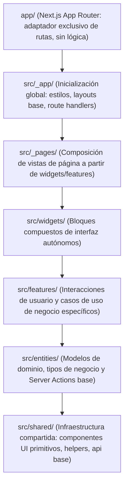

# 🍳 AGENTS.md — Guía y Reglas del Proyecto CocinaOS

Este documento define los principios arquitectónicos, herramientas, directrices de diseño y flujos de trabajo obligatorios para cualquier agente de IA o desarrollador que trabaje en el repositorio **CocinaOS**.

---

## 1. Contexto y Visión del Proyecto

- **Producto:** CocinaOS es un sistema operativo de inventario y gestión para cocinas profesionales (restaurantes, obradores, catering).
- **Usuarios principales:** Chefs, jefes de cocina y personal de operaciones culinarias.
- **Idioma:** La interfaz de usuario, nombres de campos, estados culinarios y terminología de negocio deben estar **estrictamente en español**.
- **Stack tecnológico base:**
  - Next.js 16 (App Router) + React 19
  - Tailwind CSS v4 + Base UI + Shadcn UI
  - API HTTP en Python con FastAPI (`apps/api`)
  - Orval para generar los tipos TypeScript del contrato OpenAPI
  - TypeScript 5 (modo estricto) + Vitest + pnpm

---

## 2. Arquitectura: Feature-Sliced Design (FSD v2.1) — Obligatoria a Rajatabla

La arquitectura sigue de forma estricta y sin excepciones la metodología **Feature-Sliced Design**. Toda nueva funcionalidad, refactorización o cambio de código debe respetar la jerarquía de capas, la regla de aislamiento y el uso de Public APIs.

### 2.1 Jerarquía de Capas (Layers)

El flujo de dependencias es **estrictamente unidireccional hacia abajo**:

### 2.2 Reglas de Oro de FSD

1. **Regla de importación descendente (Unidirectional Imports):**
   - Un módulo **solo** puede importar de capas que estén **estrictamente por debajo** de la suya.
   - `src/entities/*` **JAMÁS** puede importar de `features`, `widgets`, `_pages` o `_app`.
   - `src/features/*` **JAMÁS** puede importar de `widgets` ni de `_pages`.
   - `src/shared/*` no puede importar de ninguna capa superior; solo de dependencias externas y de sí mismo.
2. **Aislamiento horizontal entre Slices (Cross-slice imports prohibidos):**
   - Una slice dentro de una capa no puede importar directamente de otra slice de la misma capa.
   - Prohibido: `src/features/dish/...` importando directamente de `src/features/ingredient/...`.
   - Si dos features necesitan interactuar, la coordinación debe hacerse en una capa superior (`widgets` o `_pages`), o bien descender la lógica común a `entities` o `shared`.
3. **Public API obligatoria (`index.ts`):**
   - Cada slice o segmento debe definir un archivo `index.ts` que actúe como barrera de exportación.
   - Las capas superiores deben importar **únicamente** a través del `index.ts` público de la slice.
   - Permitido: `import { createIngredient } from '@/entities/ingredient'`
   - Prohibido: `import { createIngredient } from '@/entities/ingredient/api/ingredient.actions'`
4. **Separación de la capa `app/` (Next.js):**
   - El directorio raíz `app/` funciona exclusivamente como adaptador de enrutado de Next.js.
   - Los archivos `app/**/page.tsx` y `app/**/layout.tsx` deben ser delgados: exportar la página ensamblada desde `src/_pages/*` o layouts desde `src/_app/layouts/*`.

### 2.3 Aliases de Rutas (tsconfig.json)

Usar siempre los path aliases configurados en lugar de rutas relativas largas (`../../..`):

- `@/*` ➔ `./src/*`
- `@/_app/*` ➔ `./src/_app/*`
- `@/_pages/*` ➔ `./src/_pages/*`
- `@/widgets/*` ➔ `./src/widgets/*`
- `@/features/*` ➔ `./src/features/*`
- `@/entities/*` ➔ `./src/entities/*`
- `@/shared/*` ➔ `./src/shared/*`

---

## 3. API de Python y tipos generados

El frontend consume la API HTTP de FastAPI en `apps/api`. Centraliza la configuración del cliente HTTP en `src/shared/api/` y mantén las llamadas de cada entidad en su segmento `api/`. Para modificar el contrato de la API, consulta primero `apps/api/AGENTS.MD`.

- Usa el esquema OpenAPI de FastAPI como fuente de verdad. Genera con Orval todos los tipos del contrato de la API, incluidos los modelos, los parámetros y los datos de petición y respuesta.
- Guarda los tipos generados en `apps/web/src/shared/api/generated/` e impórtalos desde `@/shared/api/generated`.
- Si un tipo falta o cambia, actualiza el contrato en FastAPI y vuelve a generar los tipos con Orval. Evita duplicar el contrato en interfaces escritas a mano y editar archivos generados.
- Mantén las mutaciones en Server Actions cuando corresponda, valida sus entradas y muestra errores comprensibles para el usuario con `sonner`.

---

## 4. Uso Mandatorio de MCPs y Skills Instaladas

Los agentes deben priorizar el uso de los servidores MCP y las skills instaladas para resolver tareas especializadas:

### 4.1 Documentación de Librerías (Context7 MCP)

- Consultar siempre **Context7 MCP** (`resolve-library-id`, `query-docs`) antes de escribir código que dependa de APIs o configuraciones de frameworks y librerías clave (Next.js, React 19, Tailwind CSS v4, Base UI, Shadcn, etc.), garantizando sintaxis actual y sin alucinaciones.

### 4.2 Investigación de Patrones UI (Mobbin MCP)

- **Plugin / MCP Mobbin:** Si el plugin `mobbin` (`plugin:mobbin`) está instalado:
  - Utilizar activamente sus herramientas MCP (`search_screens`, `search_flows`, `search_sections`) y skills (`search`, `redesign-screen`, `best-practices`, `plain-writing`).
  - Buscar pantallas de referencia en aplicaciones reales de producción antes de diseñar nuevos flujos, formularios complejos, tablas de gestión o interfaces operativas.

---

## 5. 🎨 Diseño de Interfaces y Frontend

### 5.1 Skill `design-taste-frontend`

- Para el desarrollo, rediseño, restyling o revisión de componentes y pantallas, es **obligatorio invocar y seguir las directrices de la skill `@.agents/skills/design-taste-frontend`**.
- **Filosofía Anti-Slop:** Prohibida la estética genérica de IA (gradientes sin justificar, bordes tenues decorativos innecesarios, tarjetas flotantes con iconos vacíos, subtítulos monospaciados clónicos).
- **Modo Pantallas de Aplicación (`references/app-screens.md`):** CocinaOS no es una landing page de marketing; es una **herramienta de trabajo diario de alta intensidad**.
  - Priorizar densidad visual óptima, alineación precisa y números tabulares.
  - Diseñar con datos reales del dominio culinario (cantidades, mermas, unidades de peso/volumen, costes).

### 5.2 Directrices del Sistema de Diseño (`DESIGN.md`)

- **North Star:** _"El registro a la vista"_ — la cantidad, unidad y estado deben entenderse de un vistazo inmediato sin decoraciones distractoras.
- **Paleta de Colores:**
  - Azul operativo (`landing-navy`): `#112747` para navegación activa y acciones principales.
  - Lienzo claro continuo: `#f7f8f7`, con contenedores isla blancos (`#ffffff`) y bordes de `1px solid #dce3e9`.
- **The Stock First Rule:**
  - El estado de stock de cualquier fila o tarjeta debe comunicarse siempre con una **píldora semántica en pasteles desaturados y con texto explícito** (nunca depender únicamente del color):
    - _Disponible / Correcto:_ `#edf3ec` con texto `#26592b`.
    - _Stock bajo / Atención ($\le 5$ unidades):_ `#fbf3db` con texto `#8a5700`.
    - _Alerta / Agotado:_ `#fdebec` con texto `#962b29`.
- **Tipografía:**
  - Familia Figtree.
  - **Obligatorio:** Utilizar `tabular-nums` (`font-variant-numeric: tabular-nums`) en todas las columnas de cantidades, precios, pesos y métricas para alineación perfecta en tablas.
- **Shape Consistency Lock:**
  - Botones, CTAs y badges: píldora completa (`rounded-full` / `999px`).
  - Tarjetas y contenedores isla: `rounded-[20px]`.
  - Celdas y subpaneles internos: `rounded-[12px]`.

---

## 6. Filosofía de Desarrollo: Ponytail (Lazy Senior Dev Mode)

Si la skill `ponytail` está instalada en el entorno, los agentes **deben adoptar activamente su mentalidad y nivel por defecto (`full`)**:

1. **El cambio más pequeño que resuelve completamente el problema:**
   - La mejor línea de código es la que no hace falta escribir.
   - Evitar sobre-ingeniería, abstracciones prematuras y capas innecesarias ("por si acaso").
2. **YAGNI estricto:**
   - No crear wrappers, configuraciones ni helpers genéricos si nadie los ha pedido.
   - Si la plataforma (React/Next.js/HTML nativo) o una librería ya instalada provee la funcionalidad, usarla de forma directa.
3. **Reutilizar antes de inventar:**
   - Buscar primero si existe un componente en `src/shared/ui/`, una utilidad en `src/shared/lib/` o un patrón ya implementado en otra entidad/feature.
4. **Completitud y responsabilidad del cambio:**
   - Ser "vago" con la solución, pero riguroso con el impacto: actualizar siempre los llamadores (_callers_), los tipos de TypeScript y las pruebas unitarias afectadas.
5. **Atajos documentados:**
   - Si se aplica una solución provisional consciente con limitaciones conocidas, dejar un comentario explícito en formato:
     `// shortcut: <límite técnico>, <cuándo refactorizar>`
6. **Cierre de respuesta conciso:**
   - Terminar las intervenciones resumiendo en una o dos líneas lo que se resolvió, qué se omitió intencionadamente y qué riesgos o comprobaciones pendientes debe conocer el usuario.

---

## 7. Calidad, Verificación y Pruebas

- **Suite de pruebas:** Ejecutar `npx vitest run` para comprobar que todas las pruebas unitarias y de integración pasan sin errores tras modificar lógica de dominio o Server Actions.
- **Chequeo de tipos:** El código debe compilar de forma limpia bajo `tsc --noEmit` o `pnpm build`.
- **Respeto a la documentación existente:** Mantener actualizados `PRODUCT.md` y `DESIGN.md` si se introducen nuevas decisiones de producto o variantes visuales.
- **Datos sensibles:** Evita codificar identificadores o credenciales de servicios como valores de respaldo. Si falta configuración, devuelve un error explícito.

<!-- BEGIN:nextjs-agent-rules -->

# This is NOT the Next.js you know

This version has breaking changes — APIs, conventions, and file structure may all differ from your training data. Read the relevant guide in `node_modules/next/dist/docs/` (resolved from this file's directory; in monorepos the `next` package may not be visible from the repo root) before writing any code. Heed deprecation notices.

This block is written and re-added by `next dev` — verify at `node_modules/next/dist/server/lib/generate-agent-files.js`. Removing it from a diff only re-creates the uncommitted change; committing it with your work keeps the tree clean.

<!-- END:nextjs-agent-rules -->
